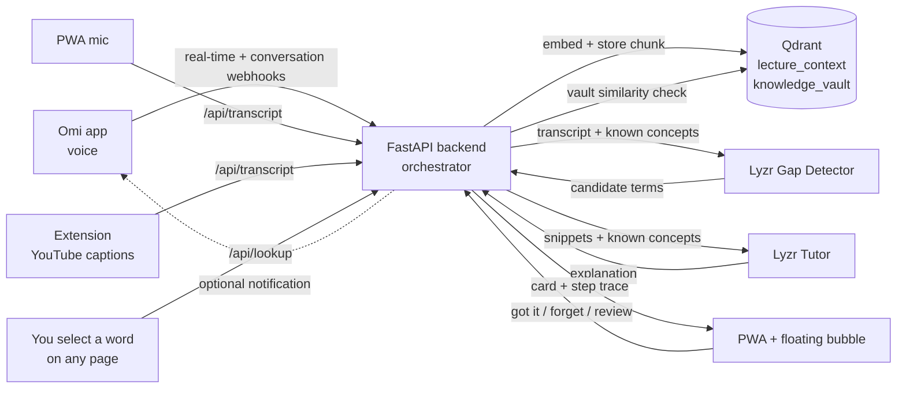

# LearnLoop — Your Proactive Learning Copilot

**Build track:** Meeting & Lecture Intelligence
**Stack:** Omi (voice) · Qdrant (semantic memory) · Lyzr (multi-agent reasoning) — one connected loop.

**Live demo:** https://learnloop-xh10.onrender.com ← open this; it *is* the `learner` identity
**Demo video:** <ADD YOUTUBE/LOOM LINK HERE>
**License:** MIT

---

## Try it in 30 seconds (no install, no phone)

1. Open https://learnloop-xh10.onrender.com — you are `learner`, shown in the header.
2. **Ask** tab → type `What is a KV cache?` → the card arrives with the full agent log
   underneath (which Qdrant collections were read, which Lyzr agent answered, how long).
3. **Vault** tab → the concept is now yours, with a Leitner review date. ✕ forgets it.
4. Want the proactive half without a phone: **Live Coach** → tap the mic → say
   *"we use beam search because the KV cache overflows"* → cards arrive for the terms
   your vault doesn't already cover.

## The problem

Watching an online course and hitting a technical term means pausing, leaving the tab,
googling, and losing your place. Browser AI helpers (like the Gemini icon) are
**reactive, page-locked, desktop-only, and forget you** the next session.

## What LearnLoop does differently

Instead of waiting to be asked, LearnLoop **listens through Omi, reads your video's captions,
and watches what you select** — then detects the terms *you specifically* are likely not to
know (because it remembers what you already know) and explains them **before you even ask**,
in plain language anchored to concepts you trust. Everything you learn becomes a persistent,
personal **knowledge vault**, with spaced-repetition review, on your phone and desktop.

| | Gemini-in-Chrome | LearnLoop |
|---|---|---|
| Trigger | You must select + ask | Proactive — before you ask |
| Memory | None | Per-user Qdrant knowledge vault |
| Personalization | Generic definition | Skipped if it's close to what you know; anchored to it otherwise |
| Devices | Desktop Chrome only | PWA (phone + desktop) + extension |
| Input | Text selection | Voice (Omi) + web mic + live captions + text selection |
| Where you end up | New tab, place lost | Card floats on the page you're already on |
| After the answer | Gone | Vault entry + spaced-repetition review |

We are not claiming to look up a word faster than Gemini. We are claiming the
other 90%: the terms you did not know to ask about, explained at the level of
what you already know, and still there next week.

---

## How Omi, Qdrant and Lyzr are used (at a glance)

| Tool | Role in the loop | Where in code |
|---|---|---|
| **Omi** | Real-time voice input. The real-time transcript and conversation webhooks feed the backend; new cards can be pushed back to the phone through Omi's notification API | `main.py` (`/omi/realtime`, `/omi/conversation`, `_notify_omi`) |
| **Qdrant** | Persistent semantic memory on Qdrant Cloud: `lecture_context` (what was said) and `knowledge_vault` (what you know, mastery, next review). Per-learner filters, a similarity check decides what you already know, and forget deletes points | `memory.py`, `config.py` |
| **Lyzr** | Agent reasoning: a Gap Detector finds terms you likely don't know, and a Tutor explains them anchored to your vault. A general Lyzr agent is the fallback for any unset role | `agents.py`, `lyzr_client.py` |

### Architecture diagram



---

## Four ways in, one loop

| Input | Path | Needs the coach switch? | Latency (measured) |
|---|---|---|---|
| **Omi voice** | `/omi/realtime`, `/omi/conversation` → proactive loop | yes | 2 cards ≈ 15 s |
| **PWA mic** | Web Speech API → `/api/transcript` → proactive loop | yes | 2 cards ≈ 15 s |
| **Live YouTube captions** | extension reads the caption track → `/api/transcript` | yes | 2 cards ≈ 15 s |
| **Select a word, any page** | chip → `POST /api/lookup` → single Tutor call | no — selecting *is* asking | 2.5–3.7 s in Lyzr, ≈8 s wall |

The first three are **proactive**: the loop runs whether or not you ask. The fourth is
**point-at-a-word**: highlight `speculative decoding` in a research paper and a
"💡 Explain in LearnLoop" chip appears under your selection; the card renders in place,
without leaving the page. It deliberately bypasses the Gap Detector (one agent call, not
three) and skips the card queue entirely — which makes it the fastest and most reliable
take to demo.

## One execution loop

```
  INPUTS                          BACKEND (FastAPI = the orchestrator)

  Omi voice     --> /omi/realtime, /omi/conversation ─┐
  PWA mic       --> /api/transcript ──────────────────┼─> PROACTIVE LOOP
  Extension     --> /api/transcript ──────────────────┘     1. vault lookup: what you know
  captions                                             
                                                        2. Lyzr Gap Detector -> candidate terms
  Selection chip -> /api/lookup ──────────────────────> SKIPS 1-2 (you already said
                                                        what you don't know): one
  Ask tab/popup  -> /api/query ───────────────────────> REACTIVE: retrieval -> Tutor
                                                        Tutor call -> direct card

                            both paths then share steps 3-5:

                                                        3. per-term vault check —
                                                           cosine >= 0.78 -> no card,
                                                           the trace says which
                                                           concept matched
                                                        4. lecture_context retrieval
                                                        5. Lyzr Tutor -> card + trace

  backend <--> Qdrant Cloud (384-dim): lecture_context + knowledge_vault, per-uid filter
  backend <--> Lyzr Agent Studio: Gap Detector · Tutor · Manager fallback
                        |
                        v
        PWA / floating-bubble card (the card carries its own step trace)
                        + optional Omi phone notification
```

- **Qdrant** holds two collections sharing one embedding space (`BAAI/bge-small-en-v1.5`,
  384-dim), both filtered per learner (`uid`) and, for lectures, per video:
  `lecture_context` (what was said) and `knowledge_vault` (what you know, mastery, next review).
- **Lyzr** runs the reasoning. The backend does the retrieval and passes grounded context to
  Lyzr, so memory stays in your Qdrant and never depends on Lyzr's own memory.
- **The extension** reads the video's own caption track (every 500 ms, flushed at 22 words or
  14 s of age, or on pause), so it works on any subtitled lecture — no download, no API key.

## The agents

Two specialised Lyzr agents do the reasoning; the backend is the orchestrator that
decides which one runs and feeds each one from Qdrant.

| Agent | Where | Job |
|---|---|---|
| **LearnLoop Gap Detector** | Lyzr (`LYZR_GAP_AGENT_ID=6acb298f3ab69773f6536ba2`, temp 0.1) | Reads the fresh transcript + your known list, returns a strict JSON array of terms you likely don't know |
| **LearnLoop Tutor** | Lyzr (`LYZR_TUTOR_AGENT_ID=6acb299135a2bbbac9f09581`, temp 0.4) | 2–3 plain sentences, grounded in the lecture snippet and anchored to concepts in your vault |
| **LearnLoop Explainer Hub** | Lyzr (`LYZR_AGENT_ID=6ac9f92a0754f223eb059fda`) | Manager/fallback: used for any role whose specialist id is unset |
| Orchestrator | `agents.py` | Vault lookups, semantic "do you already know this?" check (cosine ≥ 0.78), retrieval, routing, vault writes |

The specialist ids live in `render.yaml` / `.env.example` (they are not secrets; the API key is).

## Observable workflow

Every card carries the exact steps that produced it. Tap **"How this card was made"** to see:

```
Omi real-time transcript: 23 lecture word(s) received
Qdrant lecture_context: chunk embedded + stored (uid=learner)
Qdrant knowledge_vault: 2 concept(s) you already know
Lyzr Gap Detector agent …6ba2: 2 candidate(s) in 2.8s → rotary position embeddings, KV cache
Qdrant vault: 'KV cache' is new to you (closest: softmax, 0.54 < 0.78)
Qdrant lecture_context: 1 snippet(s) to ground it
Lyzr Tutor agent …9581: explained in 3.2s, anchored to 2 known concept(s)
```

A point-at-a-word lookup shows the short version (no Gap Detector, one Tutor call):

```
Qdrant knowledge_vault: 'complexity' is new to you (4 concept(s) checked, closest 'kubernetes' at 0.41)
Qdrant lecture_context: 3 stored snippet(s) recalled
11 word(s) of the passage you selected kept as context
Lyzr Tutor agent …9581: explained in 3.7s
Qdrant knowledge_vault: saved — it now counts as known and is scheduled for review (level 1)
```

The **Ask** tab shows the same kind of log for reactive questions.

## Personal, not generic

- **Your vault decides what gets flagged.** Terms semantically close (cosine ≥ 0.78) to
  something you know are skipped by the proactive loop, and the trace says which concept
  matched and how closely. Point-at-a-word is the exception: if you ask for a term you
  already know, it explains it again and says so in the trace.
- **Seed it in one line.** Vault → *"I already know…"* → `attention, softmax` → Add.
  The proactive loop never suggests those terms to you again.
- **Two learners, two experiences.** Open `/?as=asha` and `/?as=ravi` in two tabs, add
  different known concepts, speak the same sentence: each gets different cards.
  The header always shows who you are (`learner: ravi`). An `?as=` value is stored in
  `localStorage`, so it survives reloads; the bare URL is `learner`.

## Spaced repetition

Concepts move through Leitner levels with real intervals: **1 → 3 → 7 → 14 → 30 days**.
Vault → **Review** lists what's due. **Remembered** pushes a concept one level out,
**Forgot** resets it to tomorrow (`POST /api/review/grade`). Asking about a concept
again also levels it up.

## Privacy model

An always-on microphone over someone's lecture is only acceptable if the
learner holds the switch, so:

- **Off by default.** No transcript is analysed until **Coach: on** (`POST /api/coach {on:true}`).
  The Omi webhooks, the PWA mic and the extension all respect it; both surfaces show the state.
- **The mic stops when you leave.** Hiding the PWA tab ends capture immediately.
- **`DROP_WORDS`** discards any chunk containing a phrase you list — before it is
  embedded, stored, or sent to Lyzr.
- **Your own speech is not lecture content.** Omi's `is_user` segments are stored as
  context but never fed to the gap detector, so asking a question out loud cannot
  produce a card about your own words.
- **Selecting text is explicit consent.** That's why `/api/lookup` needs no switch —
  you asked for that one word.
- **Forget per concept.** The vault has a ✕ on every entry (`POST /api/forget`).

## Closing the loop on the phone (built, not enabled)

`_notify_omi()` pushes each new card from Omi audio back to the Omi app through Omi's
integration notification API. It is **currently disabled on the demo deploy** because
`OMI_APP_ID` / `OMI_APP_SECRET` are unset — set them and the notification line appears
in every card's trace. Cards reach the learner through the PWA either way.

## Run it locally

```bash
py -3.13 -m pip install -r requirements.txt    # Windows: use `py -3.13`, plain `python` may point at a bare install
copy .env.example .env                         # fill in LYZR_API_KEY (+ Qdrant / Omi values if used)

# Qdrant: Qdrant Cloud (set QDRANT_URL + QDRANT_API_KEY) or Docker:
docker run -p 6333:6333 -v %cd%/qdrant_storage:/qdrant/storage qdrant/qdrant:latest
#   ...or skip both: an unreachable QDRANT_URL falls back to embedded ./qdrant_data

py -3.13 -m uvicorn main:app --host 0.0.0.0 --port 8000   # serves API + PWA
```

Open http://localhost:8000. `GET /health` reports `"qdrant": "server"` or `"embedded"`,
so you can tell which store is live.

**Extension** (Chrome, desktop): `chrome://extensions` → Developer mode → *Load unpacked* →
pick the `extension/` folder. It attaches to any `http(s)` page; reload tabs opened
before install.

In Omi **Settings → Developer Settings**, enable the toggles and set:
- **Conversation Events** → `https://<your-host>/omi/conversation?uid=learner`
- **Real-time Transcript** → `https://<your-host>/omi/realtime?uid=learner&session_id=s1`

Omi rewrites `uid` with its own account id on every call, so the backend pins
inbound webhook traffic to `OMI_UID` (defaults to `DEFAULT_UID`, the identity the PWA
polls as). The real Omi account id is kept only to address notifications.

Deterministic fallback with no phone: `py -3.13 omi_replay.py`.

## Demo script (≤5 min)

1. Phone: open the live URL, leave **Live Coach** on screen, turn the coach on.
   Desktop: same URL in a second tab, extension bubble open.
2. Vault → *I already know* → show the seeded list (`attention, softmax, …`) — that list is
   what the Gap Detector is comparing against.
3. In Omi, tap the **record dot** and say a sentence containing `attention`, `KV cache`
   and `beam search`. Cards arrive for the two unknown terms only; `attention` is skipped.
4. Expand **How this card was made** → Omi → Qdrant → Lyzr Gap Detector → Qdrant → Lyzr Tutor.
5. **The fast take:** on any article or paper, select a term (try `receptive field` or
   `apriori information`) → chip → card in place in ≈8 s, with its own trace. The lookup
   writes the term straight into the Vault, so show Vault → *Known concepts* to prove it.
6. **Ask** tab → "What is KV cache?" → a grounded answer with the agent log.
7. Vault → **Review** → **Remembered** / **Forgot** to show the Leitner intervals.
8. Vault ✕ to **forget** (privacy). Name the track on screen.

Terms that reliably produce cards for the seeded `learner` vault: `KV cache`,
`beam search`, `receptive field`, `apriori information`, `branch and bound`,
`homophily`, `dropout`, `speculative decoding`. Terms the 0.78 vault gate will
*suppress* (already known to `learner`): `attention`, `softmax`, `gradient descent`,
`back propagation`, `kubernetes`, `pods`, `iterative deepening`, `vanishing gradient`.

## Known limitations — the honest list

- **No overlay on Android.** Chrome on Android loads no extensions, and a bubble that
  floats over *other* apps needs `SYSTEM_ALERT_WINDOW` plus an accessibility service —
  a native app, which a hackathon PWA can't be. On mobile the honest paths are the PWA's
  own mic and cards, and copy → paste into the **Ask** box. A native overlay is roadmap.
- **Chrome's built-in PDF viewer** hosts no content script, so selection → chip doesn't
  mount there; open the PDF in a tab served as HTML, or paste into **Ask**.
- **YouTube ingestion doesn't work from the cloud deploy.** YouTube blocks transcript
  requests from datacenter IPs, so `/api/ingest_youtube` stores nothing on Render. Run it
  from your own machine — it writes into the same Qdrant Cloud collections the deploy reads:
  `py -3.13 ingest.py <youtube_video_id> learner`. In-browser caption reading is unaffected.
- **`SURFACED` and the 0.78 gate both suppress repeats.** A term you've already been
  shown, or one close to something you know, will produce no card. That's the
  personalization working — but it means a demo term can be silently skipped if the vault
  already covers it. Check the trace, or `POST /api/forget` first.
- **Coach state and the card queue are in-process** (`ACTIVE`, `PENDING`, `SURFACED`), so a
  restart or redeploy clears them. The Qdrant memory does not reset. A `.github/workflows/keep-alive.yml`
  cron pings `/health` every 5 minutes, which keeps the free Render instance warm — that's
  why the demo responds in 0.2–0.9 s instead of sleeping.
- **One coach switch per learner, server-side.** Each bubble tracks its own on/off
  locally; opening a second bubble's coach and closing it turns detection off for the
  first tab too.

## File map

```
main.py          FastAPI: Omi webhooks, PWA API, /api/lookup, proactive queue, Omi notifications
agents.py        Orchestration of the Lyzr Gap Detector + Tutor, per-term traces
memory.py        Qdrant memory: recall, vault, closest_known, spaced repetition, forget
lyzr_client.py   REST wrapper for Lyzr Studio (specialists + manager fallback)
ingest.py        YouTube transcript -> time-chunked semantic memory (CLI too)
config.py        Env loading, Qdrant (server or embedded fallback), models
pwa/             Cross-device frontend (index/app.js/styles/manifest/sw/icon)
extension/       Chrome MV3 extension: caption reader, selection chip, floating bubble
smoke_test.py    End-to-end loop test, no external keys required
omi_replay.py    Posts spec-exact Omi payloads (deterministic demo fallback)
render.yaml      One-click Render blueprint
```

## Verification

`py -3.13 smoke_test.py` runs the memory + agent loop with the embedded Qdrant fallback
and no external keys (Lyzr calls return a clear stub when unset). The Omi leg is verified
live from the Omi phone app with **no wearable hardware**.

## Submit

Public repo · deployed PWA URL · demo video · track named above · no committed keys.

## License

MIT. See [LICENSE](LICENSE).
