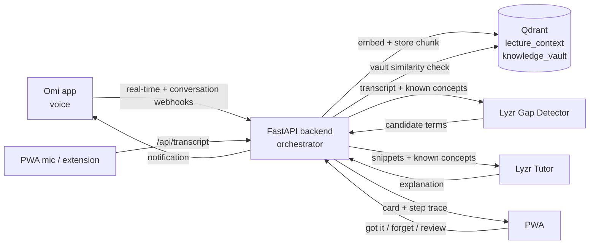

# LearnLoop — Your Proactive Voice-first Learning Copilot

**Build track:** Meeting & Lecture Intelligence
**Stack:** Omi (voice) · Qdrant (semantic memory) · Lyzr (multi-agent reasoning) — one connected loop.

**Live demo:** https://learnloop-xh10.onrender.com  (free tier: the first load after idle can take ~30-60 s to wake)
**Demo video:** <ADD YOUTUBE/LOOM LINK HERE>
**License:** MIT

## How Omi, Qdrant and Lyzr are used (at a glance)

| Tool | Role in the loop | Where in code |
|---|---|---|
| **Omi** | Real-time voice input. The real-time transcript and conversation webhooks feed the backend; new cards are pushed back to the phone through Omi's notification API | `main.py` (`/omi/realtime`, `/omi/conversation`, `_notify_omi`) |
| **Qdrant** | Persistent semantic memory on Qdrant Cloud: `lecture_context` (what was said) and `knowledge_vault` (what you know, mastery, next review). Per-learner filters, a similarity check decides what you already know, and forget deletes points | `memory.py`, `config.py` |
| **Lyzr** | Agent reasoning: a Gap Detector agent finds terms you likely don't know, and a Tutor agent explains them anchored to your vault. A general Lyzr agent is the fallback for unset roles | `agents.py`, `lyzr_client.py` |

### Architecture diagram



## The problem
Watching an online course and hitting a technical term means pausing, leaving the tab,
googling, and losing your place. Browser AI helpers (like the Gemini icon) are
**reactive, page-locked, desktop-only, and forget you** the next session.

## What LearnLoop does differently
Instead of waiting to be asked, LearnLoop **listens to the lecture through Omi**, detects the
terms *you specifically* are likely not to know (because it remembers what you already know),
and explains them **before you even ask** — in plain language anchored to concepts you trust.
Everything you learn becomes a persistent, personal **knowledge vault** on your phone and
desktop (a PWA), with spaced-repetition review. Same experience on any device.

| | Gemini-in-Chrome | LearnLoop |
|---|---|---|
| Trigger | You must select + ask | Proactive, before you ask |
| Memory | None | Per-user Qdrant knowledge vault |
| Personalization | Generic definition | Anchored to concepts you already know |
| Devices | Desktop Chrome only | PWA (phone + desktop) + extension |
| Input | Text selection | Voice (Omi) + mic + text |
| Where you end up | New tab, place lost | Card floats on the watch page itself |
| After the answer | Gone | Vault entry + spaced-repetition review |

We are not claiming to look up a word faster than Gemini. We are claiming the
other 90%: the terms you did not know to ask about, explained at the level of
what you already know, and still there next week.

## Privacy model
An always-on microphone over someone's lecture is only acceptable if the
learner holds the switch, so:
- **Off by default.** No transcript is analysed until `POST /api/coach {on:true}`.
  The web mic and the Omi webhooks both respect it; the Live Coach tab shows the state.
- **The mic stops when you leave.** Hiding the PWA tab ends capture immediately.
- **`DROP_WORDS`** discards any chunk containing a phrase you list — before it is
  embedded, stored, or sent to Lyzr.
- **Your own speech is not lecture content.** Omi's `is_user` segments are stored as
  context but never fed to the gap detector, so asking a question out loud cannot
  produce a card about your own words.
- **Forget per concept.** The vault has a ✕ on every entry (`POST /api/forget`).

## Architecture (one execution loop)

```
        Omi app (voice)                         PWA mic / Chrome extension
   realtime + conversation hooks                 (works on any device)
              \                                       /
               v                                     v
        ┌──────────── FastAPI backend (orchestrator) ─────────────┐
        |  /omi/* , /api/transcript  -> embed + store chunk        |
        |                                                          |
        |  Proactive loop (background task):                       |
        |   vault lookup -> Lyzr Gap Detector -> vault check per   |
        |   term -> lecture retrieval -> Lyzr Tutor -> card        |
        |                                                          |
        |  Reactive /api/query:                                    |
        |   lecture + vault retrieval -> Lyzr Tutor -> vault write |
        └───────|-------------------------------|------------------┘
                v                               v
          Qdrant Cloud (384-dim)          Lyzr Agent Studio
      lecture_context + knowledge_vault   Gap Detector · Tutor · Manager
                \                               /
                 v                             v
     PWA card (with step trace)  +  Omi phone notification (closes the loop)
```

- **Omi** streams voice into `/omi/realtime` (while listening) and `/omi/conversation` (after).
- **Qdrant** holds two collections sharing one embedding space (`bge-small-en-v1.5`, 384-dim),
  both filtered per learner (`uid`) and, for lectures, per video:
  `lecture_context` (what was said) and `knowledge_vault` (what you know, mastery, next review).
- **Lyzr** runs the reasoning. The backend does the retrieval and passes grounded context to
  Lyzr, so memory stays in your Qdrant and never depends on Lyzr's own memory.

## The agents
Two specialised Lyzr agents do the reasoning; the backend is the orchestrator that
decides which one runs and feeds each one from Qdrant.

| Agent | Where | Job |
|---|---|---|
| **LearnLoop Gap Detector** | Lyzr (`LYZR_GAP_AGENT_ID`, temp 0.1) | Reads the fresh transcript + your known list, returns a strict JSON array of terms you likely don't know |
| **LearnLoop Tutor** | Lyzr (`LYZR_TUTOR_AGENT_ID`, temp 0.4) | Two-sentence explanation grounded in the lecture snippet and anchored to concepts in your vault |
| **LearnLoop Explainer Hub** | Lyzr (`LYZR_AGENT_ID`) | Manager/fallback: used for any role whose specialist id is unset |
| Orchestrator | `agents.py` | Vault lookups, semantic "do you already know this?" check (cosine ≥ 0.78), retrieval, routing, vault writes |

The specialist ids live in `render.yaml` / `.env.example` (they are not secrets; the API key is).

## Observable workflow
Every proactive card carries the exact steps that produced it. Tap
**"How this card was made"** on a card to see, for example:

```
Omi real-time transcript: 23 lecture word(s) received
Qdrant lecture_context: chunk embedded + stored (uid=learner)
Qdrant knowledge_vault: 2 concept(s) you already know
Lyzr Gap Detector agent …6ba2: 2 candidate(s) in 2.8s → rotary position embeddings, KV cache
Qdrant vault: 'KV cache' is new to you (closest: softmax, 0.54 < 0.78)
Qdrant lecture_context: 1 snippet(s) to ground it
Lyzr Tutor agent …9581: explained in 3.2s, anchored to 2 known concept(s)
Omi notification pushed to your phone
```

The **Ask** tab shows the same kind of log for reactive questions.

## Personal, not generic
- **Your vault decides what gets flagged.** Terms semantically close to something you
  know are skipped, and the trace says which concept matched and how closely.
- **Seed it in one line.** Vault tab → *"I already know…"* → `attention, softmax` → Add.
  Those terms are never explained to you again.
- **Two learners, two experiences.** Open `/?as=asha` and `/?as=ravi` in two tabs, add
  different known concepts, speak the same sentence: each gets different cards.

## Spaced repetition
Concepts move through Leitner levels with real intervals: **1 → 3 → 7 → 14 → 30 days**.
Vault → **Review** lists what's due. **Remembered** pushes a concept one level out,
**Forgot** resets it to tomorrow (`POST /api/review/grade`). Asking about a concept
again also levels it up.

## Closing the loop on the phone
If `OMI_APP_ID` and `OMI_APP_SECRET` are set, each new card from Omi audio is also
pushed back to the Omi app as a notification via Omi's integration notification API, so
the explanation reaches you without opening the PWA. Without them, cards still appear in the PWA.

## Known limitation: YouTube on the cloud deploy
YouTube blocks transcript requests from cloud IPs (Render included), so `/api/ingest_youtube`
stores nothing when it runs on the deploy. Run ingestion from your own machine instead; it writes
into the same Qdrant Cloud collections the deploy reads:
```bash
py -3.13 ingest.py <youtube_video_id> learner
```

## File map
```
main.py          FastAPI: Omi webhooks, PWA API, proactive queue, Omi notifications
agents.py        Orchestration of the Lyzr Gap Detector + Tutor, step traces
memory.py        Qdrant memory: recall, vault, closest_known, spaced repetition, forget
lyzr_client.py   REST wrapper for Lyzr Studio (specialists + manager fallback)
ingest.py        YouTube transcript -> time-chunked semantic memory (CLI too)
config.py        Env loading, Qdrant (server or embedded fallback), models
pwa/             Cross-device frontend (index/app.js/styles/manifest/sw/icon)
extension/       Chrome extension (progressive enhancement)
smoke_test.py    End-to-end loop test, no external keys required
omi_replay.py    Posts spec-exact Omi payloads (deterministic demo fallback)
render.yaml      One-click Render blueprint
```

## Setup
```bash
py -3.13 -m pip install -r requirements.txt    # Windows: use `py -3.13`, plain `python` may point at a bare install
copy .env.example .env                         # fill in LYZR_API_KEY (+ Qdrant / Omi values if used)

# Qdrant: Qdrant Cloud (set QDRANT_URL + QDRANT_API_KEY) or Docker:
docker run -p 6333:6333 -v %cd%/qdrant_storage:/qdrant/storage qdrant/qdrant:latest
#   ...or skip both: an unreachable QDRANT_URL falls back to embedded ./qdrant_data

py -3.13 -m uvicorn main:app --host 0.0.0.0 --port 8000   # serves API + PWA
```
`GET /health` reports `"qdrant": "server"` or `"embedded"`, so you can tell which store is live.

In Omi **Settings → Developer Settings**, enable the toggles and set:
- **Conversation Events** → `https://<your-host>/omi/conversation?uid=learner`
- **Real-time Transcript** → `https://<your-host>/omi/realtime?uid=learner&session_id=s1`

Omi rewrites `uid` with its own account id on every call, so the backend pins
inbound webhook traffic to `OMI_UID` (defaults to `DEFAULT_UID`, the identity the
PWA polls as). The real Omi account id is kept only to address notifications.

Deterministic fallback with no phone: `py -3.13 omi_replay.py`.

## Demo script (≤5 min)
1. Open the PWA on your phone and leave **Live Coach** on screen; turn the coach on.
2. Vault → *I already know* → add `attention, softmax`.
3. In Omi, tap the **record dot** and say a sentence with `attention`, `KV cache` and
   `rotary position embeddings`. Cards arrive for the two unknown terms only; `attention` is skipped.
4. Expand **How this card was made** to show Omi → Qdrant → Lyzr Gap Detector → Qdrant → Lyzr Tutor.
5. Tap **Got it** → the card enters the Vault; **Ask** about it → grounded answer with agent log.
6. Vault ✕ to **forget** (privacy). Name the track on screen.

## Verification
`py -3.13 smoke_test.py` runs the memory + agent loop with the embedded Qdrant fallback
and no external keys (Lyzr calls return a clear stub when unset). The Omi leg is verified
live from the Omi phone app with **no wearable hardware**.

## Submit
Public repo · deployed PWA URL · demo video · track named above · no committed keys.

## License
MIT. See [LICENSE](LICENSE).
